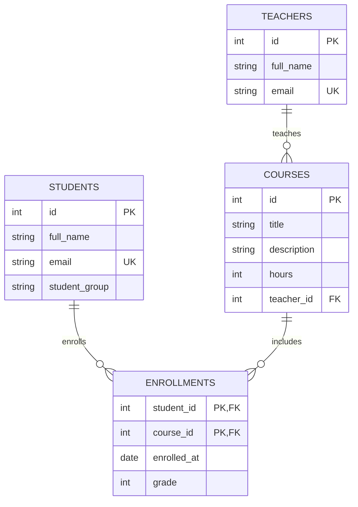

# Зертханалық жұмыс: Оқу орталығы

**Тақырып:** реляциялық дерекқорлар, PostgreSQL, Sequelize ORM және REST API.

## 1. ER-диаграмма



**Байланыстар:** оқытушы → курс (1:N); студент ↔ курс (M:N), `enrollments` арқылы. `enrollments` құрамдас бастапқы кілті `(student_id, course_id)` бір студенттің бір курсқа екі рет жазылуына жол бермейді. `grade` — NULL немесе 0–100, `hours` > 0, email бірегей.

## 2. Неліктен 3ҚФ?

Әр кестеде жазбаны бірмәнді анықтайтын бастапқы кілт бар, сондықтан қайталанатын топтар жоқ (1ҚФ). Құрама кілті бар `enrollments` кестесіндегі `enrolled_at` пен `grade` толық `(student_id, course_id)` жұбына тәуелді, оның бір бөлігіне ғана тәуелді емес (2ҚФ). Оқытушының аты мен email-і `courses` кестесінде қайталанбайды, олар тек `teachers` кестесінде сақталады. Кілттік емес атрибуттар басқа кілттік емес атрибуттар арқылы анықталмайды, яғни транзитивті тәуелділіктер жоқ (3ҚФ).

## 3. Орнату және іске қосу

1. [Neon](https://neon.com/) сайтында PostgreSQL жобасын ашып, **Connection string** көшіріңіз.
2. GitHub Codespaces немесе Node.js (18+) орнатылған терминалда осы репозиторийді ашыңыз.
3. `npm install` орындаңыз.
4. `.env.example` файлын `.env` деп көшіріп, `DATABASE_URL` мәнін өз Neon URL-іңізбен ауыстырыңыз. **`.env` файлын GitHub-қа жүктемеңіз.**
5. Neon SQL Editor ішінде алдымен `sql/schema.sql`, одан кейін `sql/seed.sql` кодтарын орындаңыз.
6. `sql/queries.sql` файлын SQL Editor ішінде орындаңыз. Ескерту: транзакция мысалы `(5,3)` жазбасын сақтайды; оны қайта іске қосу үшін алдымен сол жазбаны жойыңыз немесе басқа жұп таңдаңыз.
7. `npm test` — ORM демонстрациясы; `npm start` — API сервері. **`sequelize.sync()` қолданылмайды**, себебі схема SQL арқылы жасалады.
8. Codespaces **Ports** панелінен 3000 портын ашыңыз.

## 4. REST API

| Әдіс | Маршрут | Мақсаты | Жауап |
|---|---|---|---|
| GET | `/courses` | Курстарды оқытушыларымен алу | 200 |
| GET | `/courses/:id` | Курсты ID бойынша алу | 200 / 400 / 404 |
| POST | `/courses` | Курс құру | 201 / 400 / 404 |
| PUT | `/courses/:id` | Курсты өзгерту | 200 / 400 / 404 |
| DELETE | `/courses/:id` | Курсты жою | 200 / 400 / 404 |
| POST | `/enrollments` | Студентті курсқа жазу | 201 / 400 / 404 / 409 |
| GET | `/students/:id/courses` | Студенттің курстары және бағалары | 200 / 400 / 404 |

## 5. curl арқылы тексеру

```bash
# Барлық курстар
curl http://localhost:3000/courses

# Бір курс
curl http://localhost:3000/courses/1

# Курс қосу (мұғалім id=1 seed.sql ішінде бар)
curl -X POST http://localhost:3000/courses -H 'Content-Type: application/json' -d '{"title":"SQL","description":"Практикалық SQL","hours":40,"teacherId":1}'

# Курсты өзгерту (6 ID — бастапқы seed-тен кейінгі жаңа курс)
curl -X PUT http://localhost:3000/courses/6 -H 'Content-Type: application/json' -d '{"hours":45}'

# Студентті курсқа жазу (қайталанбаған жұп)
curl -X POST http://localhost:3000/enrollments -H 'Content-Type: application/json' -d '{"studentId":5,"courseId":2,"grade":null}'

# Студент курстары
curl http://localhost:3000/students/1/courses

# Жаңа курсты жою
curl -X DELETE http://localhost:3000/courses/6
```

**Жауап үлгілері (иллюстрациялық, нақты сервер нәтижесі емес):**

POST `/courses` → HTTP 201:
```json
{"id":6,"title":"SQL","description":"Практикалық SQL","hours":40,"teacherId":1}
```

POST `/enrollments` → HTTP 201:
```json
{"studentId":5,"courseId":2,"enrolledAt":"2026-11-12","grade":null}
```

Қайталанған жазылу → HTTP 409:
```json
{"error":"Student is already enrolled in this course"}
```

Белгісіз курс → HTTP 404:
```json
{"error":"Course not found"}
```

Жарамсыз сағат саны → HTTP 400:
```json
{"error":"Provide title, positive integer hours and valid teacherId"}
```

## 6. Репозиторий құрылымы

```text
lab-db/
├── README.md
├── sql/
│   ├── schema.sql
│   ├── seed.sql
│   └── queries.sql
├── src/
│   ├── db.js
│   ├── test.js
│   └── server.js
├── package.json
├── .env.example
└── .gitignore
```

## 7. GitHub-қа жіберу

```bash
git add .
git commit -m "Complete PostgreSQL ORM REST API lab"
git push
```

Оқытушыға GitHub репозиторий сілтемесін жіберіңіз. Құпия Neon паролі `.env` ішінде ғана қалуы керек.
